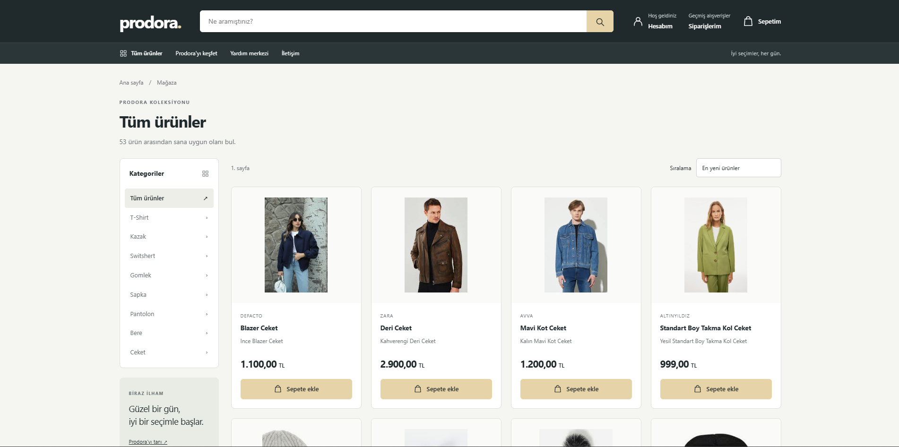
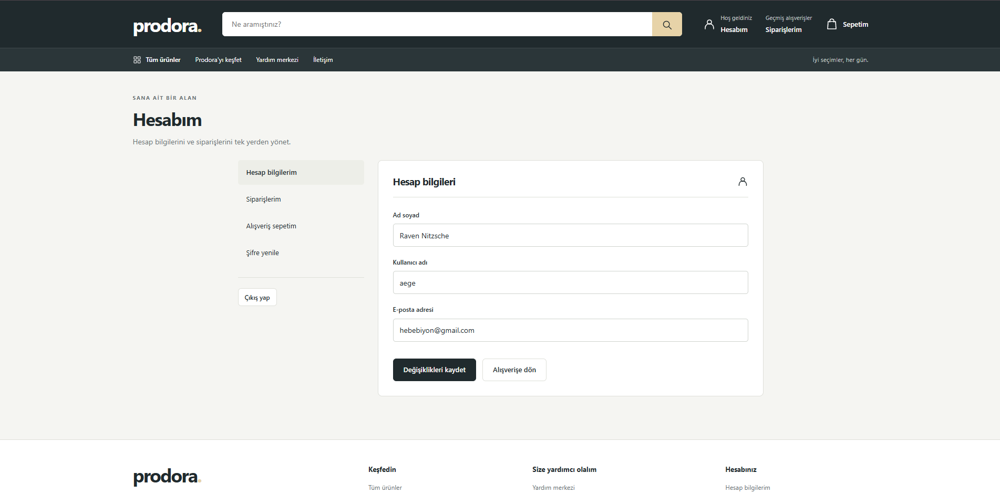
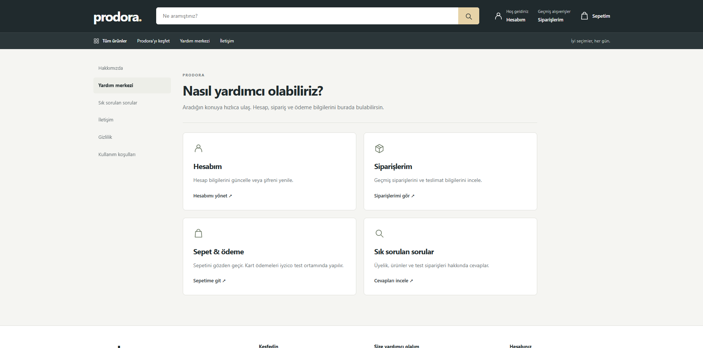
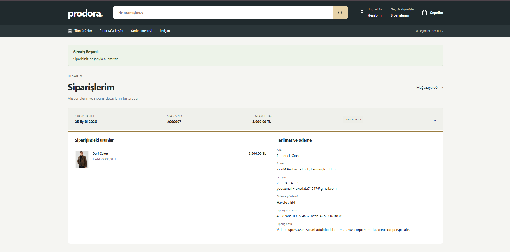
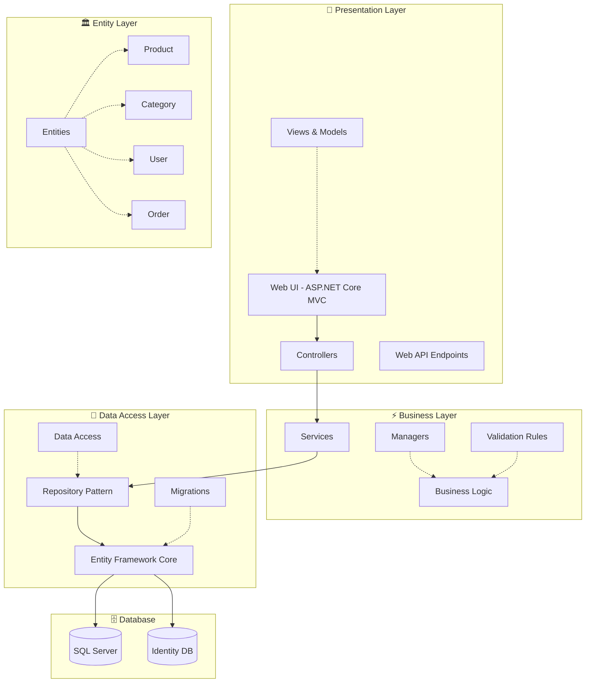
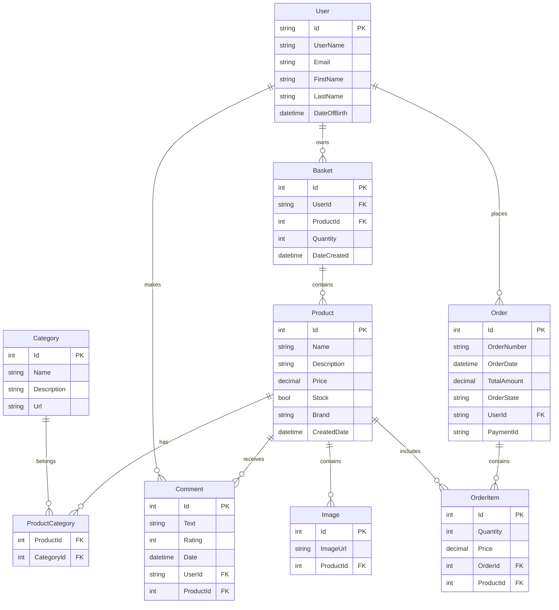

# 🛍️ PRODORA - Modern E-Ticaret Platformu

<div align="center">


**🚀 Next Generation E-Commerce Platform with Advanced Features**

[](https://dotnet.microsoft.com/)
[](https://docs.microsoft.com/en-us/dotnet/csharp/)
[](https://docs.microsoft.com/en-us/ef/)
[](https://www.microsoft.com/en-us/sql-server)
[](https://getbootstrap.com/)


</div>

---

## 📸 Ekran Görüntüleri

<div align="center">

### 🛍️ Mağaza & Ürün Listesi


### 👤 Hesabım & ❓ Yardım Merkezi



### 📦 Siparişlerim


</div>

---

## 🎯 Proje Özeti

**Prodora**, modern e-ticaret ihtiyaçlarına yönelik geliştirilmiş, tam özellikli bir online alışveriş platformudur. Katmanlı mimari (N-Tier Architecture) kullanılarak geliştirilmiş, güvenli ve ölçeklenebilir bir yapıya sahiptir.

### 👤 Kullanıcı Rolleri

- **Admin:** Ürün ve kategori yönetimi, kullanıcı yönetimi, sistem ayarları.
- **Kullanıcı:** Ürünleri görüntüleme, sepete ekleme, sipariş verme, profil yönetimi.

---

## 🏗️ Mimari Yapı

<div align="center">



</div>

---

## 💻 Teknoloji Stack'i

<div align="center">

### �️ Backend Teknolojileri

| Teknoloji | Versiyon | Kullanım Alanı | Açıklama |
|-----------|----------|----------------|-----------|
|  | **8.0** | 🏗️ **Core Framework** | Ana uygulama framework'ü |
|  | **11.0** | 💻 **Programming Language** | Ana programlama dili |
|  | **8.0** | 🌐 **Web Framework** | MVC pattern, Web API |
|  | **8.0** | 🗄️ **ORM** | Code-First, Migration, LINQ |
|  | **2019+** | 💾 **Database** | İlişkisel veritabanı |
|  | **8.0** | 🔐 **Authentication** | Kullanıcı yönetimi ve güvenlik |

### 🎨 Frontend Teknolojileri

| Teknoloji | Versiyon | Kullanım Alanı | Açıklama |
|-----------|----------|----------------|-----------|
|  | **5** | 📝 **Markup** | Semantic HTML yapısı |
|  | **3** | 🎨 **Styling** | Modern CSS, Flexbox, Grid |
|  | **ES6+** | ⚡ **Scripting** | DOM manipulation, AJAX |
|  | **5.2** | 📱 **UI Framework** | Responsive design, Components |
|  | **3.6** | 🔧 **Library** | DOM operations, AJAX calls |
|  | **6.0** | 🎭 **Icons** | Modern icon library |

### 🔧 Geliştirme Araçları

| Araç | Kullanım Alanı | Açıklama |
|------|----------------|-----------|
|  | 🛠️ **IDE** | Ana geliştirme ortamı |
|  | 🗄️ **Database Tool** | Veritabanı yönetimi |
|  | 📝 **Version Control** | Kaynak kod yönetimi |
|  | 📦 **Package Manager** | .NET paket yönetimi |

</div>

---

## 🚀 Özellikler

<div align="center">

### 👥 Kullanıcı Özellikleri

</div>

| Özellik | Durum | Açıklama |
|---------|-------|----------|
| 🔐 **Kullanıcı Kayıt/Giriş** | ✅ | E-posta doğrulamalı hesap oluşturma |
| 🛍️ **Ürün Görüntüleme** | ✅ | Kategorilere göre filtreleme ve arama |
| 🛒 **Sepet İşlemleri** | ✅ | Ürün ekleme, çıkarma, güncelleme |
| 💳 **Ödeme Sistemi** | ✅ | Iyzico entegrasyonu ile güvenli ödeme |
| 📝 **Yorum & Değerlendirme** | ✅ | Ürünlere yorum yapma ve puanlama |
| 📧 **E-posta Bildirimleri** | ✅ | Hesap doğrulama ve sipariş bildirimleri |
| 📱 **Responsive Tasarım** | ✅ | Mobil uyumlu modern arayüz |
| 🔍 **Gelişmiş Arama** | ✅ | Fiyat aralığı ve kategori filtreleri |
| ❌ **Sipariş İptali & İade** | ✅ | Hazırlanmadan önce iptal; kartla ödenenler iyzico üzerinden iade edilir |
| 🎟️ **Kupon Kodu** | ✅ | Ödemede yüzde veya sabit tutar indirimi, kişi başı tek kullanım |

<div align="center">

### 👨‍💼 Admin Özellikleri

</div>

| Özellik | Durum | Açıklama |
|---------|-------|----------|
| 📊 **Dashboard** | ✅ | Satış istatistikleri ve genel bakış |
| 🏷️ **Ürün Yönetimi** | ✅ | CRUD işlemleri, resim yükleme |
| 📂 **Kategori Yönetimi** | ✅ | Kategori ekleme, düzenleme, silme |
| 👥 **Kullanıcı Yönetimi** | ✅ | Rol bazlı yetki kontrolü |
| 📋 **Sipariş Takibi** | ✅ | Durum ilerletme, kargo takip numarası, yönetici iptali ve iadesi |
| 🎟️ **Kupon Yönetimi** | ✅ | Kod, indirim türü, alt sepet tutarı, son gün ve kullanım sınırı |
| 💬 **Yorum Moderasyonu** | ✅ | Yorumları onaylama/reddetme |
| 📈 **Raporlama** | ✅ | Satış ve kullanıcı raporları |
| 🔧 **Sistem Ayarları** | ✅ | Genel sistem konfigürasyonu |

---

## 📁 Proje Yapısı

<div align="center">

```
📦 Prodora Solution
├── 🏛️ Prodora.Entitys                 # Entity Layer
│   ├── 📄 Product.cs                  # Ürün entity'si
│   ├── 📄 Category.cs                 # Kategori entity'si
│   ├── 📄 Order.cs                    # Sipariş entity'si
│   ├── 📄 Comment.cs                  # Yorum entity'si
│   ├── 📄 Basket.cs                   # Sepet entity'si
│   └── 📄 Image.cs                    # Resim entity'si
├── 💾 Prodora.DataAccess              # Data Access Layer
│   ├── 📁 Abstract/                   # Interface'ler
│   │   ├── 📄 IRepository.cs          # Generic repository
│   │   ├── 📄 IProductDal.cs          # Ürün data access
│   │   ├── 📄 ICategoryDal.cs         # Kategori data access
│   │   └── 📄 ...                     # Diğer DAL interface'leri
│   ├── 📁 Concrate/EfCore/            # EF Core implementasyonları
│   │   ├── 📄 DataContext.cs          # DbContext
│   │   ├── 📄 EfCoreProductDal.cs     # Ürün EF implementasyonu
│   │   ├── 📄 EfCoreCategoryDal.cs    # Kategori EF implementasyonu
│   │   └── 📄 ...                     # Diğer EF implementasyonları
│   └── 📁 Migrations/                 # EF Core migration'ları
├── ⚡ Prodora.Business                # Business Layer
│   ├── 📁 Abstract/                   # Service interface'leri
│   │   ├── 📄 IProductServices.cs     # Ürün service interface
│   │   ├── 📄 ICategoryServices.cs    # Kategori service interface
│   │   └── 📄 ...                     # Diğer service interface'leri
│   └── 📁 Concrate/                   # Service implementasyonları
│       ├── 📄 ProductManager.cs       # Ürün business logic
│       ├── 📄 CategoryManager.cs      # Kategori business logic
│       └── 📄 ...                     # Diğer manager sınıfları
└── 🌐 Prodora.WebUI                   # Presentation Layer
    ├── 📁 Controllers/                # MVC Controller'lar
    │   ├── 📄 HomeController.cs       # Ana sayfa
    │   ├── 📄 ShopController.cs       # Mağaza işlemleri
    │   ├── 📄 AccountController.cs    # Hesap işlemleri
    │   ├── 📄 AdminController.cs      # Admin panel
    │   └── 📄 BasketController.cs     # Sepet işlemleri
    ├── 📁 Views/                      # Razor View'lar
    │   ├── 📁 Home/                   # Ana sayfa view'ları
    │   ├── 📁 Shop/                   # Mağaza view'ları
    │   ├── 📁 Account/                # Hesap view'ları
    │   ├── 📁 Admin/                  # Admin view'ları
    │   └── 📁 Shared/                 # Paylaşılan view'lar
    ├── 📁 Models/                     # ViewModel'ler
    ├── 📁 wwwroot/                    # Static dosyalar
    │   ├── 📁 css/                    # CSS dosyaları
    │   ├── 📁 js/                     # JavaScript dosyaları
    │   ├── 📁 img/                    # Resim dosyaları
    │   └── 📁 Prodora-İmage/          # Proje ekran görüntüleri
    ├── 📁 Identity/                   # ASP.NET Identity
    ├── 📁 Extensions/                 # Extension method'lar
    ├── 📁 Middlewares/               # Custom middleware'ler
    └── 📄 Program.cs                  # Uygulama başlangıç noktası
```

</div>

---

## 🎯 Design Patterns & Architectures

<div align="center">

| Pattern/Architecture | Kullanım Alanı | Açıklama |
|---------------------|----------------|-----------|
| 🏗️ **N-Tier Architecture** | Genel mimari | Katmanlı mimari yapısı |
| 📦 **Repository Pattern** | Data Access | Veri erişim soyutlaması |
| 🔧 **Dependency Injection** | IoC Container | Bağımlılık enjeksiyonu |
| 🎭 **MVC Pattern** | Web Layer | Model-View-Controller |
| 🏭 **Manager Pattern** | Business Layer | İş mantığı yönetimi |
| 🔍 **Generic Repository** | Data Access | Tip güvenli veri işlemleri |
| 🛡️ **Transaction Yönetimi** | Data Access | `CommerceTransaction` ile sepet ve ödeme yazmalarında kilitli transaction |

</div>

---

## 🗄️ Veritabanı Şeması

<div align="center">



</div>

---

## � Kurulum ve Çalıştırma

### 📋 Gereksinimler

-  **.NET 8.0 SDK** veya üzeri
-  **SQL Server 2019+** veya **SQL Server Express**
-  **Visual Studio 2022** (önerilen)

### 🚀 Adım Adım Kurulum

#### 1️⃣ **Projeyi Klonlayın**
```bash
git clone https://github.com/egeaydn/Prodora.git
cd Prodora
```

#### 2️⃣ **Veritabanı ve yerel ayarlar**

Mevcut MSSQL veritabanını kullanmak için `Prodora.WebUI/appsettings.json` içindeki `ConnectionStrings:IdentityConnection` değerini kendi SQL Server adresine göre düzenle. Ticaret tabloları varsayılan olarak aynı veritabanını kullanır; ayrı veritabanı gerekiyorsa `CommerceConnection` tanımla.

SMTP ve iyzico sandbox anahtarlarını `Prodora.WebUI/appsettings.Local.json` içinde tut. Yeni kurulumda `appsettings.Local.example.json` dosyasını bu adla kopyala; mevcut yerel dosyanın üzerine yazma. Bu dosya Git ve publish çıktısına dahil edilmez, yalnızca Development ortamında okunur.

Yayında hesap e-postalarının doğru adrese gitmesi için `Site__PublicBaseUrl` ortam değişkenini HTTPS site kökünle ayarla; `AllowedHosts` değerini gerçek alan adınla sınırla. Geliştirmede yerel loopback adresi otomatik kullanılır.

#### 3️⃣ **NuGet paketleri**

```powershell
dotnet restore
```

#### 4️⃣ **Veritabanı**

Mevcut veritabanını önce yedekle. 26 Eylül güvenilirlik migration'ı için yedekli güncelleme ve durum kontrolü [düzeltme notlarında](docs/GUVENILIRLIK_DUZELTMELERI.md) anlatılıyor. Mevcut bir veritabanında yeni migration'lar (örneğin sipariş takip numarası) için yedek aldıktan sonra aynı iki `dotnet ef database update` komutunu çalıştır. Sıfırdan kurulumda:

```powershell
dotnet ef database update --context DataContext --project Prodora.DataAccess --startup-project Prodora.WebUI
dotnet ef database update --context ApplicationIdentityDbContext --project Prodora.WebUI
```

#### 5️⃣ **Çalıştırma**

```powershell
dotnet run --project Prodora.WebUI --launch-profile http
```

Tarayıcı adresi: **http://localhost:5047**. Ödeme entegrasyonu **iyzico sandbox** ortamındadır; test kartları kullanılır.

#### 🐳 **Docker ile tek komut (yerel demo)**

```powershell
docker compose up --build
```

Uygulama + SQL Server ayağa kalkar ve migration'lar otomatik uygulanır: **http://localhost:8080**. Bu yalnızca yerel demo içindir (Development ortamı, düz HTTP). SQL şifresini değiştirmek için `MSSQL_SA_PASSWORD` ortam değişkenini ayarla. Sağlık kontrolleri: `/health` (süreç ayakta) ve `/health/ready` (veritabanlarına bağlanabiliyor); ikisi de ayrıntı döndürmez. Günlükler Serilog ile konsola yazılır. Yönetici hesabı için kayıt olduktan sonra kullanıcıyı `admin` rolüne ekle.

#### ☁️ **Azure'a yayın**

`Deploy to Azure` workflow'u (GitHub → Actions) elle tetiklenir: derler, birim testlerini çalıştırır, yayınlar ve `/health/ready` ile doğrular. Çalışması için `AZURE_WEBAPP_NAME` değişkeni ve `AZURE_WEBAPP_PUBLISH_PROFILE` gizli anahtarı tanımlanmalı; ayrıntılar workflow dosyasının başındadır.

#### 6️⃣ **Kontroller**

```powershell
dotnet run --project tools/Prodora.StoreChecks
dotnet run --project tools/Prodora.EmailPreview
dotnet test tests/Prodora.Tests
```

StoreChecks yalnızca kendi oluşturduğu geçici SQL Server veritabanlarında çalışır; gerçek e-posta veya ödeme göndermez. E-posta tasarımları `artifacts/email-previews/index.html` üzerinden incelenebilir.

---

## 🔐 Güvenlik ve sınırlar

Uygulama ASP.NET Core Identity oturum çerezi, e-posta doğrulaması, parola kuralları, rol kontrolü ve form CSRF koruması kullanır. JWT kimlik doğrulaması yoktur. HTTP geliştirme profili vardır; gerçek bir dağıtımda HTTPS ve güvenli çerez ayarları ayrıca doğrulanmalıdır.

İyzico entegrasyonu yalnızca sandbox adresine gider. Gerçek ödeme için ayrı bir operasyon ve güvenlik hazırlığı gerekir. Yerel SMTP ve sandbox anahtarları Git dışındaki `appsettings.Local.json` dosyasında tutulur. Daha önce Git'e girmiş anahtarların sağlayıcı tarafında yenilenmesi gerekir. Eski `Prodora.bak` dosyası da yeni commit'lerden çıkarılmıştır; eski commitlerde bulunmaya devam eder.

## 🧪 Kontroller

- `tools/Prodora.PasswordResetChecks`: gerçek MVC ve Identity şifre yenileme, antiforgery ve oturum senaryoları; SQL/SMTP kullanmaz.
- `tools/Prodora.EmailPreview`: dört e-posta şablonu, güvenli HTML kodlama ve bağlantı kontrolleri; e-posta göndermez.
- `tests/Prodora.Tests`: xUnit birim testleri; sipariş durum geçişleri, ödeme akışı (`CheckoutService`) ve Product/Basket/Order manager kuralları. SQL gerektirmez: `dotnet test tests/Prodora.Tests`.
- `tools/Prodora.StoreChecks`: geçici SQL Server veritabanlarında migration, sepet, sipariş, ödeme ve hesap regresyonları; gerçek iyzico çağrısı yapmaz.

GitHub Actions çözümü derler, birim testlerini ve ilk iki kontrolü çalıştırır; ayrı bir job'da SQL Server 2022 servis container'ı üzerinde StoreChecks'i de çalıştırır. Gerçek posta teslimatı, iyzico sandbox uçtan uca ödeme ve tarayıcı görsel kontrolleri ayrıca doğrulanmalıdır.

---

## 📈 Gelecek Planları

<div align="center">

### 🚀 Yakın Gelecek

</div>

| Özellik | Öncelik | Açıklama |
|---------|---------|----------|
| 📱 **Mobile App** | 🔥 **Yüksek** | React Native ile mobil uygulama |
| 🌐 **Multi-Language** | 🔥 **Yüksek** | Çoklu dil desteği |
| 📊 **Advanced Analytics** | 📊 **Orta** | Gelişmiş satış analitiği |
| 🔔 **Push Notifications** | 📊 **Orta** | Gerçek zamanlı bildirimler |
| 🎁 **Loyalty Program** | 📊 **Orta** | Müşteri sadakat programı |

<div align="center">

### 🔮 Uzun Vadeli

</div>

| Özellik | Açıklama |
|---------|----------|
| 🤖 **AI Recommendations** | Yapay zeka destekli ürün önerileri |
| 🛒 **Multi-Vendor Support** | Çok satıcılı marketplace |
| 📦 **Advanced Inventory** | Gelişmiş stok yönetimi |
| 💬 **Live Chat Support** | Canlı müşteri desteği |
| 🌍 **Global Shipping** | Uluslararası kargo entegrasyonu |

---

## 🤝 Katkıda Bulunma

Projeye katkıda bulunmak istiyorsanız:

1. 🍴 **Fork** edin
2. 🌿 **Feature branch** oluşturun (`git checkout -b feature/AmazingFeature`)
3. 💾 **Commit** edin (`git commit -m 'Add some AmazingFeature'`)
4. 📤 **Push** edin (`git push origin feature/AmazingFeature`)
5. 🔄 **Pull Request** açın

---

## 📄 Lisans

Bu proje **MIT Lisansı** ile lisanslanmıştır. Detaylar için [LICENSE](LICENSE) dosyasına bakınız.

---

## 📞 İletişim & Destek

<div align="center">

[](https://github.com/egeaydn)
[](mailto:egeaydinn31@gmail.com)
[](https://www.linkedin.com/in/ege-ayd%C4%B1n-156704317/)

**📧 Email:** egeaydinn31@gmail.com  
**🐛 Issues:** [GitHub Issues](https://github.com/egeaydn/Prodora/issues)

</div>

---

<div align="center">

### 🌟 Bu projeyi beğendiyseniz star vermeyi unutmayın!

**Made with ❤️ by [Ege Aydın](https://github.com/egeaydn)**


---

*© 2025 Prodora. Tüm hakları saklıdır.*

</div>